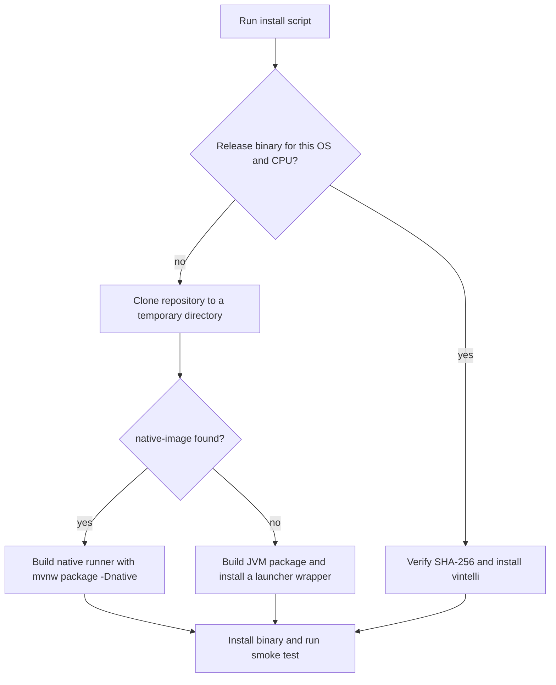
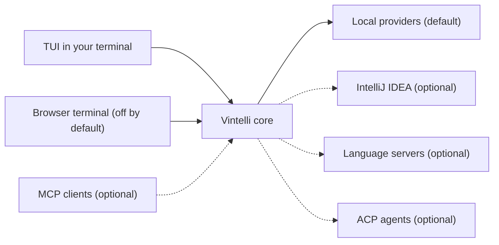

# Vintelli

[](https://scorecard.dev/viewer/?uri=github.com/omatheusmesmo/vintelli)

A terminal IDE for Java with an IntelliJ IDEA-like layout.
It runs with open tooling only. IntelliJ IDEA is an optional extra.

## Why you will like it

- 🖥️ **Work where you already are.** A full IDE layout in your terminal, with no window to open.
- ⚡ **Native when you want it.** With a GraalVM or Mandrel toolchain, the installer builds one binary that needs no JVM to run.
- 🔓 **Open tools by default.** Maven, Gradle, terminal commands and Git (JGit) need no IDE.
- ▶️ **Start the application.** Detect Quarkus, Spring Boot and configured Java application commands, choose them from the toolbar, and keep the choice per project. See [run configurations](docs/run-configurations.md).
- 🤖 **AI agents in a side panel.** Choose OpenCode, Claude Code or pi over ACP (`Alt+8`), with executable availability shown before starting a session. See [agent setup](docs/acp-agents.md).
- 🔌 **Other agents can drive it.** The MCP server reads the shell state and pushes highlights and diffs into the TUI.
- 🧠 **Language support over LSP.** Configurable profiles, with jdtls as the first one.
- ⌨️ **Familiar keys and colors.** The `intellij` keymap is the default, and the themes come from IntelliJ IDEA's color files.

## Install

```bash
curl -fsSL https://raw.githubusercontent.com/omatheusmesmo/vintelli/main/scripts/install.sh | bash
```

Windows (PowerShell):

```powershell
powershell -NoProfile -ExecutionPolicy Bypass -Command "irm https://raw.githubusercontent.com/omatheusmesmo/vintelli/main/scripts/install.ps1 | iex"
```

**You need git and JDK 25.** There is no published binary yet, so the installer builds Vintelli from source. It clones the repository into a temporary directory, builds it, installs the `vintelli` command and cleans up.

<details>
<summary>Installer options</summary>

Unix, passing options after `bash -s --`:

```bash
curl -fsSL https://raw.githubusercontent.com/omatheusmesmo/vintelli/main/scripts/install.sh | bash -s -- --dry-run
```

| Option | Effect |
|---|---|
| `--dry-run` | Print the planned actions without changing the system |
| `--prefix <dir>` | Install the `vintelli` command into `<dir>` |
| `--system` | Install system-wide instead of for the current user |
| `--version <tag>` | Install a specific release tag or git ref (default `latest`) |
| `--force` | Overwrite an existing installation without prompting |
| `--uninstall` | Remove the installed command and its runtime |
| `--source <dir>` | Build from a local clone you already have |

The same options exist in `install.ps1` on Windows. Full details: [docs/installation.md](docs/installation.md).

</details>

<details>
<summary>What the installer does</summary>



</details>

## Quick start

Open any project and go:

```bash
cd your-java-project
vintelli
```

`vintelli --help` lists every command, and `vintelli serve` runs it headless with the HTTP and MCP endpoints.

## How it works



Local providers are the default path. The dashed connections are optional, and Vintelli starts without any of them.

## Documentation

Start with [usage](docs/usage.md), the [keymap](docs/keymap.md) and [themes](docs/themes.md).

<details>
<summary>All documentation</summary>

| Topic | File |
|---|---|
| Architecture and stack | [docs/architecture.md](docs/architecture.md) |
| Installation details | [docs/installation.md](docs/installation.md) |
| Usage: run modes, CLI and TUI shell | [docs/usage.md](docs/usage.md) |
| Logging | [docs/logging.md](docs/logging.md) |
| Keymap | [docs/keymap.md](docs/keymap.md) |
| Themes and colors | [docs/themes.md](docs/themes.md) |
| File icons | [docs/file-icons.md](docs/file-icons.md) |
| MCP server, HTTP endpoints and browser terminal | [docs/mcp-server.md](docs/mcp-server.md) |
| IntelliJ IDEA provider | [docs/intellij-idea.md](docs/intellij-idea.md) |
| Native image | [docs/native-image.md](docs/native-image.md) |
| Language servers | [docs/language-servers.md](docs/language-servers.md) |
| ACP agents | [docs/acp-agents.md](docs/acp-agents.md) |
| Run configurations | [docs/run-configurations.md](docs/run-configurations.md) |

</details>

## Status

Vintelli is pre-release, with no published binary yet. See the GitHub issues for the plan (IDEA MCP integration, ACP agents, offline inspections, WebSocket surface, native smoke test).

<details>
<summary>For AI agents and contributors</summary>

Setup and build (`sdk env` honors `.sdkmanrc` for Java 25):

```bash
sdk env
./mvnw package
java -jar vintelli-app/target/quarkus-app/quarkus-run.jar
./mvnw -B -ntp -T 1C -pl vintelli-app -am package -Dtest=<Class> -Dsurefire.failIfNoSpecifiedTests=false
./mvnw verify -Dnative -Dquarkus.native.container-build
```

Modules: `vintelli-app` (the application), `vintelli-tui` (TamboUI shell), `vintelli-core` (Quarkus extension), `vintelli-api` and `vintelli-jsonrpc` (plain Java), `vintelli-local`, `vintelli-lsp` and `vintelli-idea`.

Read [AGENTS.md](AGENTS.md) and [CONTRIBUTING.md](CONTRIBUTING.md) before changing code. The topic files in `docs/` hold the details.

</details>

## Contributing

See [CONTRIBUTING.md](CONTRIBUTING.md) for how to set up, propose changes, and meet the review bar.

## License

Vintelli is licensed under the [Apache License, Version 2.0](LICENSE).
