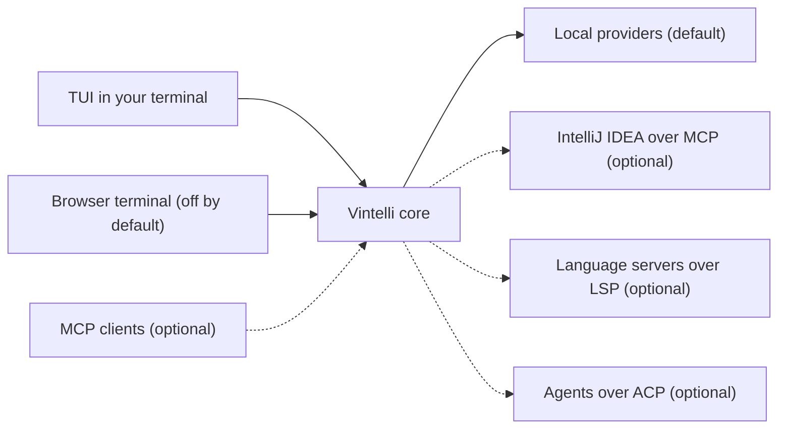

# Architecture and stack

How Vintelli is built: the overview, the component map and the stack it runs on.

A terminal-native IDE experience for Java: IntelliJ intelligence, in your terminal, with zero IDE UI.

Vintelli is a Quarkus application that shows an IntelliJ IDEA-like TUI (built with TamboUI) and hosts AI coding agents (OpenCode, Claude Code, pi) through the Agent Client Protocol (ACP). It works standalone with open tooling only. IntelliJ IDEA, driven headlessly through its MCP server, is an optional provider and is never required.

## Architecture

Local providers are the default path. Every dashed connection is optional.

## Stack

- Java 25 (Mandrel 25.0.2, the Red Hat build of GraalVM for native images, pinned by `.sdkmanrc`)
- Quarkus 3.40.1.1 (build-time-first, no proxies/reflection unless required)
- TamboUI 0.6.0 (`tamboui-tui`, `tamboui-toolkit` with the CSS style engine, Markdown support, JLine backend)
- Quarkiverse MCP Server 2.0.4 (Vintelli as an MCP server for external agents)
- MCP Java SDK 2.1.0 (client: IntelliJ IDEA MCP server)
- LSP4J 1.0.0 (client: generic language server client with profiles)
- JGit 7.8.1 directly from Eclipse JGit (local Git provider; native registrations are maintained by the Vintelli core build step)
- AEsh 3.18.6 (plain library; CLI/REPL capabilities) and WebSockets Next (browser surface)
